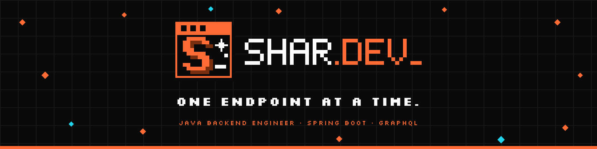

<div align="center">



**Professional portfolio of Sharlton Romero · Java Backend Engineer**

🚧 Under construction · [shardev-portfolio.vercel.app](https://shardev-portfolio.vercel.app)

</div>

## About

**SHAR.DEV** is the personal brand and professional portfolio of Sharlton Romero, a Java Backend Engineer based in San José, Costa Rica, with 2+ years of experience building REST and GraphQL APIs with Java and Spring Boot in a Fortune 500 environment.

This repository holds the **launch page of the new SHAR.DEV visual identity**: a single page with the logo, the slogan and an "under construction" notice, published while the full portfolio is being redesigned around that identity.

## Where the project stands

- [x] Brand, slogan and logo defined
- [x] Favicon, color palette (light and dark) and typography defined
- [x] Presentation background and page style defined
- [x] Professional profile, mission, vision and values written (English and Spanish)
- [x] Under-construction page published
- [ ] Redesign of the full portfolio with the new identity (home, experience, skills, projects, contact)
- [ ] Dark mode
- [ ] Bilingual content, English first and Spanish as support

## Visual identity

| | |
|---|---|
| **Brand** | SHAR.DEV |
| **Slogan** | *One endpoint at a time.* · *Un endpoint a la vez.* |
| **Logo** | Retro terminal window with an "S", a cursor and a sparkle. Pixel art built only from rectangles, so it is a true vector and stays sharp at any size |
| **Favicon** | "S_" monogram taken from the logo screen |
| **Style** | Pixel art / retro gaming: thick borders, hard shadows, grid backgrounds |
| **Titles** | [Silkscreen](https://fonts.google.com/specimen/Silkscreen) |
| **Body text** | [Space Grotesk](https://fonts.google.com/specimen/Space+Grotesk) |

### Color palette (60-30-10 rule)

| | Light mode | Dark mode |
|---|---|---|
| **60 %** · brand | Pixel Orange `#FF6B35` | Terminal Green `#4ADE80` |
| **30 %** · structure | Ink Black `#0A0A0A` | Mist Gray `#D4D4D8` |
| **10 %** · accent (hover, focus, active) | Cursor Cyan `#22D3EE` | Pulse Pink `#F472B6` |
| Background (outside the rule) | `#FAFAFA` | `#0A0A0A` |

Text on orange, green and pink is always black, which keeps contrast above WCAG AA.

## About this page

A static page: plain HTML and CSS, no dependencies and no build step. Fonts are self-hosted and the page respects `prefers-reduced-motion`. It is deployed on Vercel from the `main` branch.

```
index.html                     Page
favicon.svg / .ico             Favicon
apple-touch-icon.png           iOS icon
assets/
  banner.png                   Banner used in this README
  shardev-navbar-dark.svg      Logo for dark backgrounds
  fonts/                       Silkscreen and Space Grotesk (OFL license)
```

## Contact

✉️ [sromerobpersonal@gmail.com](mailto:sromerobpersonal@gmail.com) · 📍 San José, Costa Rica · open to remote opportunities

---

<details>
<summary><b>🇪🇸 Versión en español</b></summary>

### Sobre el proyecto

**SHAR.DEV** es la marca personal y el portafolio profesional de Sharlton Romero, Ingeniero Backend Java en San José, Costa Rica, con más de 2 años de experiencia construyendo APIs REST y GraphQL con Java y Spring Boot en un entorno Fortune 500.

Este repositorio contiene la **página de lanzamiento de la nueva identidad visual de SHAR.DEV**: una sola página con el logotipo, el eslogan y un aviso de sitio en construcción, publicada mientras el portafolio completo se rediseña con esa identidad.

### Estado actual

- [x] Marca, eslogan y logotipo definidos
- [x] Favicon, paleta de colores (claro y oscuro) y tipografía definidos
- [x] Fondo de presentación y estilo de página definidos
- [x] Perfil profesional, misión, visión y valores redactados (inglés y español)
- [x] Página en construcción publicada
- [ ] Rediseño del portafolio completo con la nueva identidad (inicio, experiencia, habilidades, proyectos, contacto)
- [ ] Modo oscuro
- [ ] Contenido bilingüe, inglés como idioma principal y español de apoyo

### Identidad visual

- **Marca:** SHAR.DEV · **Eslogan:** *One endpoint at a time.* (*Un endpoint a la vez.*)
- **Logotipo:** ventana de terminal retro con una «S», un cursor y un destello. Pixel art hecho solo con rectángulos, por lo que es vectorial y se ve nítido a cualquier tamaño.
- **Favicon:** monograma «S_» derivado de la pantalla del logotipo.
- **Estilo:** pixel art / retro gaming, con bordes gruesos, sombras duras y fondos de cuadrícula.
- **Tipografía:** Silkscreen para títulos y Space Grotesk para párrafos.
- **Paleta 60-30-10:** en modo claro, naranja `#FF6B35` (60 %), negro `#0A0A0A` (30 %) y cian `#22D3EE` (10 %); en modo oscuro, verde `#4ADE80`, gris `#D4D4D8` y rosa `#F472B6`.

### Sobre esta página

Página estática (HTML y CSS, sin dependencias ni paso de compilación), con las fuentes alojadas localmente y respeto por `prefers-reduced-motion`. Se publica en Vercel desde la rama `main`.

</details>
